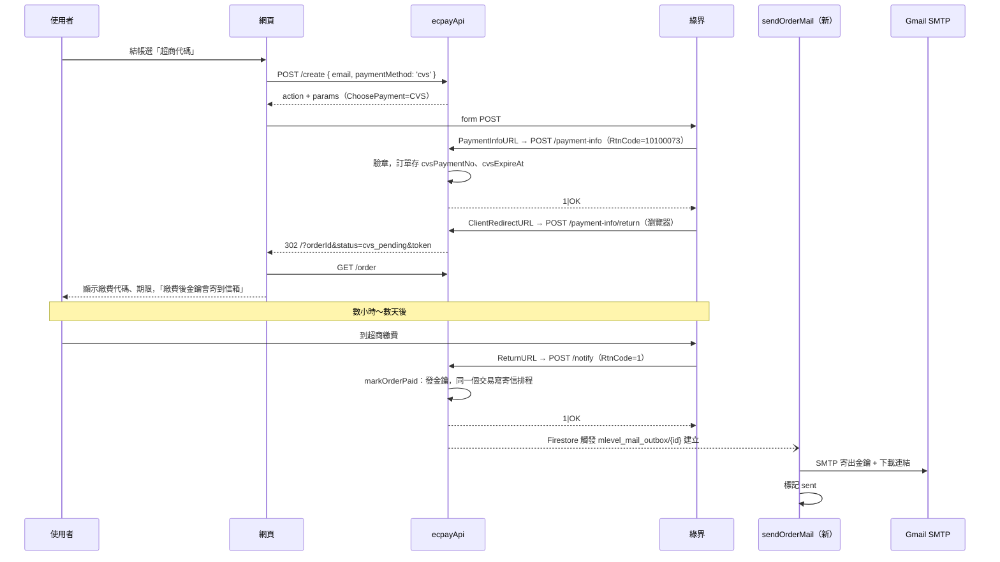

# MLevel 超商代碼付款 + Gmail 寄送金鑰規劃

2026-10-12

**狀態：已實作，尚未部署（2026-10-12）。** 本機 emulator 測試通過（新增 58 項、既有續訂 48 項）。還沒做：瀏覽器手動測試、綠界測試站實測、真的用 Gmail 寄出、部署。「開工前必須確認」第 1 件（綠界同意）沒有確認前不要上線。實作細節與規劃的差異見文末「實作紀錄」。

**已決定（2026-10-12）：** 信用卡付款也寄信；超商繳費期限 3 天；取號後的繳費提醒信先不做；email 防呆採「重複輸入 + 送出前彈窗確認 + 取號結果頁顯示遮罩信箱」。見「決策紀錄」。

## 目標

1. 結帳時可以選「超商代碼」（7-11、全家、萊爾富、OK 臨櫃繳費），新購與續訂都能用
2. 付款成功後，用 Gmail 把**授權金鑰、有效期限、安裝檔與使用手冊下載連結**寄到購買時填的信箱
3. 信用卡付款也一起寄信（同一條流程，新購與續訂都寄）
4. 舊版 PC 腳本、既有訂單、既有金鑰完全不受影響

超商代碼一定要做寄信：使用者是在建單後**幾小時到幾天**才去超商繳費，付款完成時根本不在我們的網頁上，現在「付款後頁面直接顯示金鑰」的做法拿不到金鑰。

## 開工前必須確認

| # | 事項 | 為什麼 |
| --- | --- | --- |
| 1 | **向綠界確認 MLevel 可以用超商代碼收款** | 綠界「取號結果通知」文件原文：「請勿使用超商代碼販售『遊戲點數(卡)』、『遊戲虛寶』，如經檢舉或稽核屬實，綠界及超商有權限制您的繳費金額或終止使用權益。」MLevel 是遊戲輔助程式的軟體授權，不是點數或虛寶，但和遊戲相關，**要先拿到綠界業務的書面確認**，否則可能連信用卡收款一起被停權 |
| 2 | 正式特店（`ECPAY_MERCHANT_ID`）已開通超商代碼 | 超商代碼要另外申請、有單筆金額上下限和手續費，依合約而定。綠界文件沒寫上下限，NT$399 一般在範圍內，但要在廠商後台確認 |
| 3 | 準備寄信用的 Gmail 帳號，開兩步驟驗證並產生應用程式密碼 | 見「Gmail 設定」。建議開一個專用帳號（例如 `mlevel.service@gmail.com`），不要用個人信箱 |

## 現況

| 端 | 現況 | 依據 |
| --- | --- | --- |
| 後端 | `buildEcpayOrder` 寫死 `ChoosePayment: 'Credit'`，並帶 `OrderResultURL` | `functions/ecpay.js:155-168` |
| 後端 | `/create`、`/renew` 寫入訂單時 `paymentMethod: 'credit_onetime'`，沒有讓前端選付款方式 | `functions/index.js:1014`、`:1243` |
| 後端 | `/notify` 只在 `RtnCode === 1` 時呼叫 `markOrderPaid`，其他代碼一律回 `1\|OK` | `functions/index.js:1053-1059` |
| 後端 | `markOrderPaid` 不分付款方式：驗 MerchantID、拒絕 `SimulatePaid=1`、比對金額、交易內發金鑰，續訂分給 `applyRenewal` | `functions/index.js:478-542` |
| 後端 | `/result` 是信用卡付款後的瀏覽器導回（`OrderResultURL`），驗章後把 `token` 帶回網頁 | `functions/index.js:1064-1125` |
| 後端 | 回呼存檔欄位白名單 `CALLBACK_FIELDS` 沒有超商代碼的 `PaymentNo`、`ExpireDate` | `functions/index.js:107-115` |
| 後端 | 下載連結 `buildDownloadUrl` = `/download?orderId&token`，每次下載都重查付款狀態與到期日，可以長期放在信裡 | `functions/index.js:665-679`、`:1682-1716` |
| 後端 | 沒有任何寄信功能，也沒有 Firestore 觸發器；`package.json` 沒有 mail 套件 | `functions/package.json` |
| 網頁 | 結帳只顯示「💳 信用卡一次付清」，說明寫「目前不會寄送任何信件」 | `src/components/CheckoutModal.vue:89`、`:105` |
| 網頁 | 付款回跳讀 `?orderId&status&token`，`status` 預設 `success`；結果頁只處理 `paid`、`review`、cancel | `src/App.vue:36-53`、`src/components/LicenseResult.vue:33`、`:90`、`:132` |
| 網頁 | FAQ 寫「透過綠界 ECPay 信用卡一次付清」 | `src/components/FaqSection.vue:8` |
| PC 腳本 | 只呼叫 `/verify`、`/session/*`、`/update/*`，不碰付款或訂單 | `mlevel/license_gate.py:42-44`、`mlevel/updater_client.py` |
| Firestore | 規則全部拒絕前端存取；沒有自訂索引 | `firestore.rules`、`firestore.indexes.json` |

## 綠界超商代碼規格重點

以下摘自綠界官方文件（[超商代碼](https://developers.ecpay.com.tw/2874.md)、[取號結果通知](https://developers.ecpay.com.tw/2881.md)），實作前再核對一次。

- **非同步付款，有兩次回呼**：
  1. 取號完成（建單後立即）→ `PaymentInfoURL`，`RtnCode = 10100073`，帶 `PaymentNo`（繳費代碼）、`ExpireDate`（`yyyy/MM/dd HH:mm:ss`）。**10100073 是取號成功，不是失敗**
  2. 使用者到超商繳費後 → `ReturnURL`（我們的 `/notify`），`RtnCode = 1`
- `OrderResultURL` **不支援** ATM／CVS／BARCODE，所以 `/result` 在超商代碼流程不會被呼叫
- `ClientRedirectURL`：取號完成後把**使用者瀏覽器**帶回特店頁面並附上繳費資訊。設了它，`ClientBackURL` 的返回按鈕會失效。綠界要求「請勿使用 ClientRedirectURL 通知為付款結果，應使用 PaymentInfoURL 為主要通知內容」
- `StoreExpireDate`：繳費期限，單位**分鐘**，預設 10080（7 天），上限 43200（30 天）
- `Desc_1`～`Desc_4`：各 20 字，只在全家、7-11 的繳費機螢幕顯示
- 兩個回呼都要驗 CheckMacValue、回純文字 `1|OK`；沒回對會每 5～15 分鐘重送，一天四次
- **逾期沒繳不會有任何回呼**，訂單會一直停在待付款
- 超商代碼不能用 API 退款，只能在綠界後台或找綠界客服人工處理
- 測試環境沒有真的超商可以繳，只能用廠商後台「模擬付款」，回呼會帶 `SimulatePaid=1`（見「測試」）

## 設計

### 流程



信用卡流程只多最後三步（寄信），其餘不動。

### 1. 後端：建立超商代碼訂單

**`/create`、`/renew` 新增選填欄位 `paymentMethod`**（`'credit'` | `'cvs'`）。

- 沒帶或不認得的值 → 一律走信用卡，行為和現在完全相同（舊網頁、快取中的舊 JS 都不帶這個欄位）
- 訂單的 `paymentMethod` 欄位：信用卡維持 `'credit_onetime'`，超商代碼寫 `'cvs'`
- 回應格式不變（`ok, merchantTradeNo, accessToken, action, params`，續訂另有 `currentExpiresAt`）

**`ecpay.js`**：`buildEcpayOrder` 加 `input.paymentMethod` 分支，**信用卡分支的參數一個都不改**（改了 CheckMacValue 輸入就變了，雖然演算法沒動，但沒必要冒險）。超商代碼分支：

```js
{
  // 共用欄位同信用卡：MerchantID、MerchantTradeNo、MerchantTradeDate、PaymentType、
  // TotalAmount、TradeDesc、ItemName、ReturnURL、EncryptType
  ChoosePayment: 'CVS',
  StoreExpireDate: String(CVS_EXPIRE_MINUTES),   // 4320 分鐘 = 3 天（已決定）
  PaymentInfoURL: `${callbackBaseUrl}/payment-info`,
  ClientRedirectURL: `${callbackBaseUrl}/payment-info/return`,
  Desc_1: 'MLevel 月訂閱授權',
  Desc_2: '繳費後金鑰寄到購買信箱',
  // 不帶 OrderResultURL（CVS 不支援）、不帶 ClientBackURL（被 ClientRedirectURL 蓋掉）
}
```

`CheckMacValue` 照舊用 `generateCheckMacValue` 算，演算法不動。

### 2. 後端：新增兩個路由（只增不改）

| 路由 | 呼叫者 | App Check | 行為 |
| --- | --- | :---: | --- |
| `POST /payment-info` | **綠界伺服器**（PaymentInfoURL） | | 驗章 → `ORDER_ID_PATTERN` → MerchantID 比對 → `RtnCode === 10100073` 時在訂單寫入繳費資訊。不論結果，驗章過就回 `1\|OK`；驗章失敗回 `0\|CheckMacValue Error`（同 `/notify`） |
| `GET/POST /payment-info/return` | **綠界導回瀏覽器**（ClientRedirectURL） | | 驗章 → 同上寫入繳費資訊（冪等，誰先到都可以）→ 讀訂單的 `redirectBaseUrl`，302 到 `/?orderId=…&status=cvs_pending&token=…`。驗章沒過不給 `token`（和 `/result` 同一條規則，`index.js:1102-1107`） |

**寫入繳費資訊**（兩個路由共用一個 `recordPaymentInfo(merchantTradeNo, payload)`）：

- 用交易讀訂單；訂單不存在、已是 `paid` 就不寫
- 金額比對：`TradeAmt` 要等於訂單 `amount`（沿用 `paidAmountMatches`）
- 寫入新欄位：`cvsPaymentNo`、`cvsExpireAt`（Timestamp，`ExpireDate` 以台北時間解析）、`ecpayTradeNo`、`ecpayPaymentInfo`（`pickCallbackFields` 過濾後的回呼）
- **不動** `status`（維持 `pending`）、`ecpayRawResult`（留給付款成功的那次回呼）
- 綠界重送時內容相同，重寫一次無害

`GET /` 的 `routes` 清單把兩個新路由加進去。`APPCHECK_PATHS` 不加（綠界送不了 App Check token）。

`CALLBACK_FIELDS` 白名單新增：`PaymentNo`、`ExpireDate`、`Barcode1`、`Barcode2`、`Barcode3`、`PayFrom`。驗章本來就是「綠界送什麼全部算」，白名單只影響存進 Firestore 的欄位，不影響驗章。

### 3. 後端：付款成功（不用改判斷邏輯）

超商繳費成功的回呼和信用卡一樣打 `/notify`、`RtnCode = 1`，`markOrderPaid` 已經不分付款方式：

- 新購 → 發金鑰、`licenseExpiresAt = 付款時間 + 30 天`（從**繳費時間**起算，不是建單時間）
- 續訂 → `applyRenewal` 延長原始訂單
- 冪等、金額比對、拒絕模擬付款都沿用

唯一的改動是**在同一個交易裡排寄信**（見下一節）。

### 4. 寄信：Firestore outbox + 觸發器

**為什麼不在 `/notify` 裡直接寄：**

- 綠界要求 `ReturnURL` 10 秒內回 `1|OK`，SMTP 連線慢或 Gmail 暫時失敗會拖垮回呼，導致綠界重送
- Cloud Functions v2 回應送出之後 CPU 會被收走，「先回 `1|OK` 再寄」不可靠
- 寄失敗要能重試，不能因為寄信失敗就不發金鑰

**做法：**

1. `markOrderPaid` 與 `applyRenewal` 在**發金鑰的同一個交易**裡 `tx.create()` 一筆 `mlevel_mail_outbox/{merchantTradeNo}_paid`
   - 文件 ID 固定 → 綠界重送、`/notify` 和 `/result` 都打進來時，第二次 `create` 會被交易擋下（其實前面的 `status === 'paid'` 就已經先 return 了，這是第二道保險）
   - 只在「這次交易真的把訂單從 pending 變成 paid」時建立；已付款直接 return 的分支不建
2. 新增一支 function `sendOrderMail`：`onDocumentCreated('mlevel_mail_outbox/{mailId}')`，`retry: true`
3. `sendOrderMail` 流程：
   - 交易把 `status` 從 `queued` 改成 `sending`（已是 `sent` 就結束 → 觸發器至少一次送達，不會重複寄）
   - 重新讀訂單（以及續訂的原始訂單，用 `licenseSourceFor`），組信件內容。**金鑰不存進 outbox**，outbox 只放 `orderId`、`kind`，避免金鑰多一份副本
   - nodemailer 寄出 → `status: 'sent'`、`sentAt`、`messageId`
   - 失敗 → `status: 'failed'`、`attempts + 1`、`lastError`（不含信件內容），丟出錯誤讓觸發器重試；`attempts >= 5` 就不再丟錯，留給客服
4. 收件人用訂單的 `email`（購買時填的，`/create` 已驗 `EMAIL_PATTERN`）

outbox 文件欄位：

| 欄位 | 說明 |
| --- | --- |
| `orderId` | 觸發寄信的訂單（續訂是續訂訂單） |
| `kind` | `license_issued`（新購）、`license_renewed`（續訂）。繳費提醒信 `cvs_code` 這次不做，之後要加只需新增一種 kind |
| `status` | `queued` → `sending` → `sent` / `failed` |
| `attempts`、`lastError`、`createdAt`、`sentAt`、`messageId` | 營運用 |

客服補寄：把 outbox 文件的 `status` 改回 `queued` 不會觸發（只監聽建立），所以補寄 = 刪掉文件後重建，或之後加一支 `onDocumentUpdated` 監聽 `status` 改成 `resend`。第一版先用「刪掉重建」，寫進客服手冊。

### 5. 信件內容

- 寄件人：`MLevel <GMAIL_USER>`，`Reply-To` 設客服信箱
- 主旨：`【MLevel】你的授權金鑰（訂單 MLxxxxxxxx）`；續訂：`【MLevel】續訂完成，到期日已延長`
- 內容（純文字 + HTML 兩份，HTML 內所有變數 `escapeHtml`）：
  - 授權金鑰（續訂寫「沿用原本這組」）
  - 有效期限（台北時間）
  - 安裝檔下載連結：`buildDownloadUrl(apiBaseUrl, order, 'app')`
  - 使用手冊下載連結：`buildDownloadUrl(apiBaseUrl, order, 'manual')`
  - 說明：連結每次下載都會重新驗證授權、拿到的一律是最新版；授權到期後連結失效，續訂後恢復；連結遺失可用官網「找回授權」
  - 「請勿轉寄這封信：金鑰和下載連結等同你的授權」
- `apiBaseUrl`：觸發器沒有 request，直接用 `ECPAY_CALLBACK_BASE_URL`（`getApiBaseUrl` 本來就優先讀它，`index.js:423-429`）。沒設定就不寄並標 `failed`（`MISSING_BASE_URL`），不要寄出沒有連結的信
- 下載連結含 `accessToken`。它本來就會出現在付款回跳網址，現在多出現在使用者自己的信箱，風險相當；信裡不放 `/order` 連結（那會吐出完整訂單資訊）
- log 只記 `orderId`、`kind`、`maskEmail(email)`，**不記金鑰、完整信箱、信件內容**

### 6. Gmail 設定

採 **Gmail SMTP + 應用程式密碼**（nodemailer），不用 Gmail API：

| 方案 | 優點 | 缺點 |
| --- | --- | --- |
| **SMTP + 應用程式密碼（採用）** | 設定最少；個人 Gmail 也能用；nodemailer 一個套件 | 密碼等級等同帳號權限，要放 Secret Manager；個人帳號每日約 500 封上限 |
| Gmail API + OAuth refresh token | 權限可縮到只能寄信 | 要建 OAuth 用戶端、做同意畫面；個人帳號的 refresh token 在測試模式 7 天過期 |
| Gmail API + 服務帳號 | 不用 refresh token | 只有 Google Workspace 能用網域委派 |

步驟：

1. 專用 Google 帳號開兩步驟驗證 → 「應用程式密碼」產生 16 碼密碼
2. `firebase functions:secrets:set GMAIL_APP_PASSWORD`（**不要放 `functions/.env`**，`.env` 的值任何有專案讀取權的人都看得到，見 `.env.example` 的說明）
3. `functions/.env` 新增：
   ```
   # 付款成功寄金鑰信。false 時不建立 outbox、不寄信（行為同現在）
   MLEVEL_MAIL_ENABLED=false
   GMAIL_USER=mlevel.service@gmail.com
   MLEVEL_MAIL_FROM_NAME=MLevel
   MLEVEL_MAIL_REPLY_TO=
   ```
4. `sendOrderMail` 用 `defineSecret('GMAIL_APP_PASSWORD')` 並在 options 綁 `secrets`；`ecpayApi` 不需要這個 secret
5. nodemailer：`host: 'smtp.gmail.com', port: 465, secure: true`，連線逾時 10 秒。Cloud Functions 只擋 25 port，465 可用
6. `functions/package.json` 加 `nodemailer`

`MLEVEL_MAIL_ENABLED=false` 時 `markOrderPaid` 不建 outbox，部署後可以先確認回呼正常再打開。

每日上限：個人 Gmail 約 500 封、Workspace 約 2000 封，目前銷量遠低於此。超過會被暫停寄信約 24 小時，`failed` 的信之後手動補寄。

### 7. 逾期未繳

綠界逾期不通知，訂單會一直是 `pending`。不做排程，在讀取時判斷：

- `orderPublicView` 新增 `cvsExpired`：`status === 'pending' && cvsExpireAt <= now`
- 網頁看到 `cvsExpired` 顯示「繳費期限已過，請重新下單」
- 不改訂單 `status`（避免和遲到的付款回呼打架；真的在期限後付款成功，`markOrderPaid` 照樣開通）

### 8. 網頁

| 檔案 | 改動 |
| --- | --- |
| `src/lib/ecpay.js` | `createEcpayOrder`、`createRenewalOrder` 原樣轉送 payload，不用改；呼叫端多帶 `paymentMethod` |
| `CheckoutModal.vue` | 付款方式改成可選的兩個選項（信用卡、超商代碼）；超商代碼說明「建單後 3 天內到 7-11／全家／萊爾富／OK 繳費，繳費後金鑰與下載連結會寄到這個信箱」；`:89` 的「目前不會寄送任何信件」改成「付款完成後會把金鑰寄到這個信箱」。email 防呆見下方「Email 防呆」 |
| `RenewModal.vue` | 同樣加付款方式選項。**不加 email 重複輸入與彈窗**：續訂的 email 必須和原始訂單相符才建得了單（`findOwnedPaidOrder`，`index.js:767`），信也寄到原始訂單的 email（`index.js:1237`），打錯只會被擋下、不會寄錯 |
| `App.vue` | `readPaymentReturn` 不用改（`status` 原樣傳下去） |
| `LicenseResult.vue` | 新增 `status === 'cvs_pending'`／`order.paymentMethod === 'cvs' && status === 'pending'` 的畫面：繳費代碼（可複製）、繳費期限、可繳費超商、**金鑰寄送信箱（遮罩後，例如 `ke***@gmail.com`，沿用 `orderPublicView` 既有的 `email` 欄位）**與「信箱不對請在繳費前聯絡客服」、「繳費後約數分鐘會寄信，也可以回到這頁或用『找回授權』查看」；`cvsExpired` 顯示重新下單。**這個狀態不輪詢**（`:33` 的條件要排除），使用者可能好幾天後才繳 |
| `LicenseResult.vue` 已付款畫面 | 加一行「金鑰也已寄到 ke***@example.com」（`MLEVEL_MAIL_ENABLED` 打開後才顯示，由後端在 `orderPublicView` 回 `mailQueued: true` 判斷） |
| `FaqSection.vue:8` | 改成「信用卡一次付清或超商代碼」，補一題「沒收到信怎麼辦」（看垃圾郵件 → 用找回授權 → 找客服） |
| `firebase.json` CSP | 不用改：超商代碼仍是 form POST 到 `payment(-stage).ecpay.com.tw`；`ClientRedirectURL` 是綠界頁面導回 Functions，不受本站 CSP 管 |

#### Email 防呆（新購結帳，信用卡與超商代碼都適用）

1. **重複輸入**：`CheckoutModal.vue` 新增「再次輸入 Email」欄位，兩欄（`trim()` 後、不分大小寫）一致才能送出，不一致時欄位下方顯示「兩次輸入的 Email 不一樣」。確認欄位設 `autocomplete="off"`，避免瀏覽器把同一個（可能打錯的）值自動填進兩欄；不擋貼上
2. **送出前彈窗確認**：按「前往付款」後先跳確認視窗（元件內的對話框，不用 `window.confirm`，才能放大字顯示信箱）：
   - 標題：「請確認收件信箱」
   - 內容：完整 email（大字）、「授權金鑰與下載連結會寄到這個信箱，填錯將無法收到。」；超商代碼另加「繳費後才會寄出」
   - 按鈕：「修改」（回到表單、聚焦 email）／「確認，前往付款」（才呼叫 `createEcpayOrder`）
3. **取號結果頁顯示遮罩信箱**：見上表 `LicenseResult.vue`，讓使用者在去超商繳費前還有機會發現打錯

防呆全部在前端，後端 `/create` 不新增欄位（不收確認用的第二個 email）。客服流程：使用者回報 email 打錯時，核對綠界交易編號（`ecpayTradeNo`／`transactionId`）後人工改訂單的 `email`，刪掉重建 outbox 文件補寄。

`orderPublicView` 新增欄位（只增）：`paymentMethod`（`'credit'` | `'cvs'`，舊訂單沒有就回 `'credit'`）、`cvsPaymentNo`、`cvsExpireAt`、`cvsExpired`、`mailQueued`。**只在 `status === 'pending'` 時回 `cvsPaymentNo`**，付款後不需要再顯示。

`/order` 需要 `token`，繳費代碼不會被猜訂單編號的人看到。

### 9. Firestore

| 集合 | 變更 |
| --- | --- |
| `mlevel_orders` | 新增欄位 `cvsPaymentNo`、`cvsExpireAt`、`ecpayTradeNo`、`ecpayPaymentInfo`；`paymentMethod` 多一個值 `'cvs'`。讀取一律容許欄位不存在 |
| `mlevel_mail_outbox`（新） | 見第 4 節。只有 Functions 存取 |
| `firestore.rules` | 不用改，`/{document=**}` 已全部拒絕，新集合自動涵蓋 |
| `firestore.indexes.json` | 不用改，outbox 只用 document id 存取 |

## 相容性檢查

| 項目 | 結果 |
| --- | --- |
| 舊版 PC 腳本 | 不受影響。PC 端只打 `/verify`、`/session/*`、`/update/*`，金鑰格式、到期日存放位置、席位都沒變。超商代碼付款發出的金鑰和信用卡一模一樣 |
| 既有 API | `/create`、`/renew` 只多一個選填 request 欄位；`/order`、`/lookup` 只多 response 欄位；`/notify`、`/result` 行為不變；新增 `/payment-info`、`/payment-info/return` |
| CheckMacValue | 演算法不動，驗章仍是全部欄位 |
| 冪等 | `/notify` 重送：`markOrderPaid` 已付款直接 return，不會重發金鑰也不會重建 outbox；`/payment-info` 重送：覆寫相同內容；寄信觸發器重送：`sending/sent` 狀態擋掉 |
| 金額比對 | `/payment-info`、`/notify` 都比對 `TradeAmt` |
| 模擬付款 | 正式環境照舊拒絕 `SimulatePaid=1` |
| 舊訂單 | 沒有 `paymentMethod`／`cvs*` 欄位，一律當信用卡、不顯示繳費資訊 |
| 舊網頁（快取） | 不帶 `paymentMethod` → 信用卡，和現在一樣 |
| 新網頁配舊後端 | 舊後端忽略 `paymentMethod`，仍走信用卡，不會壞但選了超商卻出現信用卡頁 → **一定要後端先上** |
| function 名稱、region | `ecpayApi` 不動；新增 `sendOrderMail`，region 沿用 `asia-east1` |

## 部署順序

1. **確認**：綠界書面同意、正式特店已開通超商代碼、Gmail 應用程式密碼已建立
2. **確認 Firestore 資料庫的位置**（`firebase firestore:databases:get`）。v2 Firestore 觸發器的 region 要和資料庫位置相容；若資料庫不在 `asia-east1`，`sendOrderMail` 要單獨指定對應 region
3. `firebase functions:secrets:set GMAIL_APP_PASSWORD`
4. 部署後端，`MLEVEL_MAIL_ENABLED=false`。確認信用卡新購、續訂、`/lookup`、PC 端啟動都正常（看 `firebase functions:log`）
5. 改 `MLEVEL_MAIL_ENABLED=true` 重新部署，自己用信用卡買一筆，確認收到信、連結可下載
6. 部署網頁（出現超商代碼選項）
7. 自己用超商代碼買一筆真的去繳，確認從取號到收信全程正常

回滾：網頁先退（拿掉選項即可）；後端可以只把 `MLEVEL_MAIL_ENABLED` 關掉。**已經取號、還沒繳費的超商訂單在回滾後仍會繳費並打 `/notify`**，所以後端的 `/notify` 不可退到不能處理它們的版本——目前的 `/notify` 本來就能處理（不分付款方式），只有寄信會停。

## 測試

### 本機 emulator（擴充 `scripts/renew-test.cjs` 或新增 `scripts/cvs-mail-test.cjs`）

腳本自己用測試特店 HashKey 簽回呼，和 `renew-test.cjs` 同樣做法（`local-ecpay-test-plan.md`）：

1. `/create` 帶 `paymentMethod: 'cvs'` → params 有 `ChoosePayment=CVS`、`PaymentInfoURL`、`ClientRedirectURL`、`StoreExpireDate`，沒有 `OrderResultURL`
2. `/create` 不帶、帶 `'xxx'` → 和現在的信用卡參數**逐欄位相同**
3. `/payment-info` `RtnCode=10100073` → 訂單有 `cvsPaymentNo`、`cvsExpireAt`，`status` 仍 `pending`；重送兩次結果相同；驗章錯回 `0|...`；金額不符不寫
4. `/payment-info/return` → 302 帶 `status=cvs_pending&token`；驗章錯不帶 token
5. `/order` 回 `paymentMethod: 'cvs'`、`cvsPaymentNo`；`cvsExpireAt` 改成過去 → `cvsExpired: true`
6. `/notify` `RtnCode=1` → 發金鑰、建 1 筆 outbox；重送 → 仍 1 筆、金鑰不變
7. 續訂走超商代碼 → 延長原始訂單、outbox `kind: license_renewed`
8. `MLEVEL_MAIL_ENABLED=false` → 不建 outbox
9. 既有 48 項全部重跑通過

寄信本身在 emulator 不要真的寄到 Gmail：`sendOrderMail` 讀 `MLEVEL_MAIL_TRANSPORT=json`（只在 emulator 用，nodemailer 的 `jsonTransport`）把信件內容寫 log，檢查金鑰、到期日、兩個下載連結都在、HTML 有轉義。

### 網頁（瀏覽器手動）

1. 兩次 email 不一致 → 不能送出、顯示提示；只差大小寫或前後空白 → 視為一致
2. 按「前往付款」→ 先出現確認彈窗、顯示完整 email；按「修改」不建單、回到 email 欄位；按「確認」才導向綠界
3. Esc／點遮罩關閉彈窗等同「修改」，不建單
4. 超商代碼取號後回到網站 → 顯示繳費代碼、期限、遮罩信箱
5. 續訂視窗沒有重複輸入與彈窗，行為和現在一樣

### 綠界測試環境

測試環境的超商代碼沒辦法真的繳，只能在廠商後台按「模擬付款」，而模擬付款會帶 `SimulatePaid=1`，被 `markOrderPaid` 擋下（`index.js:493`）。做法：

- 新增 `ECPAY_ALLOW_SIMULATED_PAYMENT=true`，**只有在 `getEcpayConfig().apiUrl` 是 `payment-stage` 時才生效**（和 `ECPAY_ALLOW_PUBLIC_TEST_CREDENTIALS` 同樣的保護方式，`ecpay.js:47-62`）
- 正式網址下設了這個開關要直接拋錯，不能默默放行
- 這是唯一會放寬 `markOrderPaid` 的地方，三燈 review 時要特別看

測試環境要驗的：取號頁導回、繳費代碼顯示、模擬付款後收到信。

### 正式環境

上線後自己買一筆超商代碼真的去超商繳，確認：繳費到收信的時間、信沒有進垃圾郵件、下載連結可用、PC 端用這組金鑰能啟動。

## 決策紀錄（2026-10-12）

| # | 問題 | 決定 |
| --- | --- | --- |
| 1 | 信用卡付款要不要也寄信？ | **要**。新購、續訂都寄，和超商代碼同一條流程，由 `MLEVEL_MAIL_ENABLED` 一起控制 |
| 2 | 超商繳費期限多長？ | **3 天**（`StoreExpireDate = 4320` 分鐘） |
| 3 | 取號後要不要先寄「繳費提醒」信？ | **先不做**。使用者靠取號結果頁、綠界頁面看繳費代碼。之後要做的話，在 `recordPaymentInfo` 第一次寫入時建 `{orderId}_cvs_code` outbox 即可，機制不用改 |
| 4 | email 打錯怎麼辦？ | **重複輸入 + 送出前彈窗確認 + 取號結果頁顯示遮罩信箱**（見第 8 節「Email 防呆」）；仍打錯時走客服人工改 email、補寄 |

## 尚未決定

1. **要不要做「重寄金鑰到我的信箱」？** 只輸入 email，把該信箱名下所有有效金鑰寄過去。只寄給訂單上的信箱，不會洩漏給輸入者，但要限流（共用 `tooManyLookups`），也要查 `email` 欄位（新的單欄位查詢，Firestore 自動建索引）。建議第二階段
2. **退款**：超商代碼不能線上退款，使用條款的「數位商品開通後恕不退款」不變；開通前的爭議走綠界後台人工處理
3. **隱私權說明**：現在寫「不會寄送任何信件」，要改成會寄交易通知信；若有隱私權政策頁也要同步

## 實作紀錄（2026-10-12）

### 改動的檔案

| 檔案 | 內容 |
| --- | --- |
| `functions/ecpay.js` | `buildCvsOrder`（`ChoosePayment=CVS`、`StoreExpireDate=4320`、`PaymentInfoURL`、`ClientRedirectURL`、`Desc_1/2`）；`buildEcpayOrder` 只在 `paymentMethod === 'cvs'` 時分過去，信用卡分支一行沒動。`getEcpayConfig` 多回 `allowSimulatedPayment`，正式網址設了開關直接拋錯 |
| `functions/mail.js`（新） | 信件內容（純文字 + HTML，變數一律轉義）與 nodemailer 傳輸（Gmail 465；`jsonTransport` 給 emulator） |
| `functions/index.js` | `parsePaymentMethod`；`/create`、`/renew` 收 `paymentMethod`；`CALLBACK_FIELDS` 加超商欄位；`markOrderPaid`／`applyRenewal` 在交易裡 `readMailOutbox` + `queueOrderMail`（訂單多寫 `mailQueuedAt`）；`recordPaymentInfo`、`parseEcpayTaipeiDate`；`POST /payment-info`、`GET/POST /payment-info/return`；`orderPublicView` 新欄位；新 function `sendOrderMail` |
| `functions/package.json` | 加 `nodemailer` ^7 |
| `functions/.env.example` | `ECPAY_ALLOW_SIMULATED_PAYMENT`、`MLEVEL_MAIL_ENABLED`、`GMAIL_USER`、`MLEVEL_MAIL_FROM_NAME`、`MLEVEL_MAIL_REPLY_TO` |
| `src/components/CheckoutModal.vue` | 付款方式選項、再次輸入 Email、送出前確認視窗（Esc／點遮罩 = 修改，開啟時焦點在確認按鈕） |
| `src/components/RenewModal.vue` | 付款方式選項 |
| `src/components/LicenseResult.vue` | 超商代碼待繳費畫面（代碼可複製、期限、遮罩信箱、逾期提示）；已付款畫面「也寄到了 xx***@…」 |
| `FaqSection.vue`、`HeroSection.vue`、`index.html`（結構化資料） | 付款方式與寄信文案，新增「超商代碼怎麼付」「沒收到信怎麼辦」 |
| `scripts/cvs-mail-test.cjs`（新） | 本機整合測試 58 項 |

### 和規劃不同的地方

- **outbox 不用 `tx.create`**：`create` 遇到已存在的文件會讓整個交易失敗，連帶金鑰也發不出去。改成交易裡先讀 outbox，不存在才 `set`
- **`sendOrderMail` 沒有「寄送中」鎖**：觸發器至少送達一次，加鎖的話執行到一半當掉會讓信永遠卡在 sending。只擋 `sent` 與試滿次數，極少數情況可能重複寄一封，比漏寄好
- **SMTP 失敗不記 `error.message`**：錯誤訊息常帶收件人信箱，只記 `responseCode`／`code` 與 `command`
- **`mailQueued`**：規劃寫「`MLEVEL_MAIL_ENABLED` 打開後才顯示」，實作是看訂單有沒有 `mailQueuedAt`，舊訂單與關閉寄信時自然是 false
- **Firestore 位置已確認是 `asia-east1`**，`sendOrderMail` 沿用全域 region，不用另外指定

### 本機測試設定

`functions/.env.local` 已加 `MLEVEL_MAIL_ENABLED=true`、`MLEVEL_MAIL_TRANSPORT=json`、`GMAIL_USER=test@example.com`，並新增 `functions/.secret.local`（`GMAIL_APP_PASSWORD=dummy`）。兩個檔都被 `*.local` 排除，不會進版控也不會部署。`MLEVEL_MAIL_TRANSPORT=json` 在 emulator 以外無效（看 `FUNCTIONS_EMULATOR`）。

### 本機用真的 Gmail 寄信

`scripts/mail-smoke.cjs` 在 emulator 建一筆信用卡訂單、自簽付款回呼，等 `sendOrderMail` 真的寄出：

1. `functions/.env.local`：`MLEVEL_MAIL_TRANSPORT=` 清空、`GMAIL_USER=<產生應用程式密碼的 Gmail 帳號>`
2. `functions/.secret.local`：`GMAIL_APP_PASSWORD=<16 碼應用程式密碼，去掉空白>`
3. 重啟 emulator（在原本的終端機 `Ctrl+C`，讓 `--export-on-exit` 正常存檔，不要強制結束）
4. `node scripts/mail-smoke.cjs <收件信箱>`
5. 測完改回 `MLEVEL_MAIL_TRANSPORT=json`、`GMAIL_USER=test@example.com`、`GMAIL_APP_PASSWORD=dummy`，再重啟。沒改回之前 `cvs-mail-test.cjs` 會拒絕執行

信裡的下載連結指向本機 emulator，只有這台電腦點得開。

### 綠界測試站實測（通道）

綠界伺服器的回呼（取號通知、模擬付款）打不到 `127.0.0.1`，要開通道：

1. `cloudflared tunnel --no-autoupdate --url http://127.0.0.1:5001`（已用 winget 安裝），記下 `https://<隨機>.trycloudflare.com`
2. `functions/.env.local`：`ECPAY_CALLBACK_BASE_URL=https://<隨機>.trycloudflare.com/mlevel-f575a/asia-east1/ecpayApi`、`ECPAY_ALLOW_SIMULATED_PAYMENT=true`
3. 重啟 emulator，**重新下單**（通知網址在建單時就寫進訂單）
4. 測完改回 `127.0.0.1`、`ECPAY_ALLOW_SIMULATED_PAYMENT=false`，關掉通道。通道開著時任何人拿到網址都打得到本機 emulator

### 部署步驟（取代上面「部署順序」的 3～5 步）

1. **先建 Secret，否則部署會失敗**：`sendOrderMail` 用 `defineSecret`，就算 `MLEVEL_MAIL_ENABLED=false` 部署時也要求 Secret 存在（2026-10-12 查過，目前不存在）
   ```
   firebase functions:secrets:set GMAIL_APP_PASSWORD
   ```
2. 正式 `functions/.env` 加 `GMAIL_USER=<寄件帳號>`，`MLEVEL_MAIL_ENABLED` 先不加或設 `false`。`ECPAY_ALLOW_SIMULATED_PAYMENT` **不要加**
3. `firebase deploy --only functions`。第一次部署 Firestore 觸發器會自動啟用 Eventarc 相關 API，可能要等幾分鐘或重試一次
4. 確認信用卡新購、續訂、`/lookup`、PC 端啟動正常
5. `MLEVEL_MAIL_ENABLED=true` 再部署一次，自己買一筆確認收到信
6. `npm run build` + `firebase deploy --only hosting`

### 綠界測試站實測（2026-10-13）

用 cloudflared 通道讓測試站打到本機 emulator，網頁下一筆超商代碼訂單 `ML2610121628207A3170`，在廠商後台按「模擬付款」：

| 項目 | 結果 |
| --- | --- |
| PaymentInfoURL（`/payment-info`） | ✅ 綠界伺服器打進來，存下繳費代碼與期限（`ExpireDate` = 建單後 3 天） |
| ClientRedirectURL（`/payment-info/return`） | ✅ **有帶 CheckMacValue 且驗得過**（log 有走到 `recordPaymentInfo`），導回網頁有帶 token。欄位和 PaymentInfoURL 相同 |
| 模擬付款 → `/notify` | ✅ `RtnCode=1`、`SimulatePaid=1`，在 `ECPAY_ALLOW_SIMULATED_PAYMENT=true` 下開通、發金鑰 |
| 寄信 | ✅ 用 Gmail（`mlevelcpy@gmail.com`）真的寄出 |

模擬付款的通知欄位：`CustomField1-4, MerchantID, MerchantTradeNo, PaymentDate, PaymentType, PaymentTypeChargeFee, RtnCode, RtnMsg, SimulatePaid, StoreID, TradeAmt, TradeDate, TradeNo`（沒有 `PayFrom`，因為沒帶 `NeedExtraPaidInfo`）。

**踩到的坑**：`ECPAY_CALLBACK_BASE_URL` 是 `127.0.0.1` 時，取號導回（瀏覽器）會成功、但取號通知與模擬付款（綠界伺服器）打不進來，訂單停在 pending。綠界伺服器的回呼一定要通道；而且通知網址在建單時就寫進訂單，改設定後要**重新下單**。

測完已還原 `.env.local`（通知網址回 127.0.0.1、`ECPAY_ALLOW_SIMULATED_PAYMENT=false`、寄信回 json）與 `.secret.local`（dummy），通道已關閉。cloudflared 留在電腦上（`C:\Program Files (x86)\cloudflared\`），下次可以直接用。

### 還沒驗證

- 正式環境的 Gmail 送達率（這次收件端的垃圾郵件判定請以實際收信為準）
- 瀏覽器手動測試：新購結帳的正常流程（email 輸入兩次、確認視窗、選超商代碼、取號後回到待繳費畫面）已在 2026-10-13 實測走過。還沒測：續訂視窗、兩次 email 不一致的提示、確認視窗按「修改」／Esc 不建單

### ~~還沒驗證的假設~~（已於測試站確認，見上）

- `ClientRedirectURL` 導回的內容帶 CheckMacValue、欄位和 PaymentInfoURL 相同。綠界文件沒寫清楚，**測試站實測時確認**。就算不帶，影響也有限：`/payment-info/return` 會導回 `status=cancel`、不給 token，前端會改用結帳前存在 sessionStorage 的 token（`App.vue:41-49`）去查 `/order`；只要 PaymentInfoURL 已經存好繳費代碼，結果頁會優先顯示待繳費畫面（`LicenseResult.vue` 的判斷在 cancel 之前）。換瀏覽器或無痕模式才會看到「未完成」，那時要改成導回時不看驗章結果
- 正式 Gmail SMTP 登入與送達率（垃圾郵件匣）

## 預估工作量

| 項目 | 估計 |
| --- | --- |
| 後端：`buildEcpayOrder` 分支、`/create`、`/renew`、兩個新路由、`orderPublicView` | 0.5 天 |
| 後端：outbox、`sendOrderMail`、信件範本、Secret 設定 | 1 天 |
| 網頁：結帳／續訂選項、取號結果畫面、文案 | 0.5 天 |
| 測試腳本與 emulator 驗證 | 0.5 天 |
| 綠界測試環境 + 正式環境實測、三燈 review | 0.5 天 |
