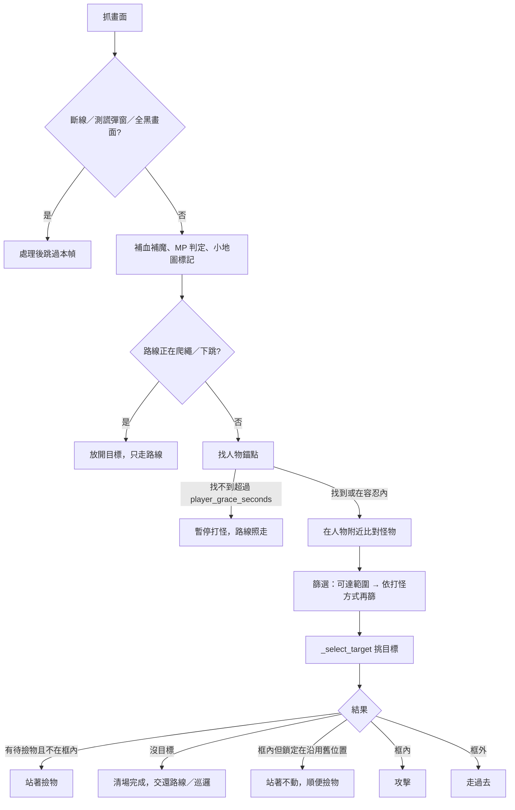

# mLevel 打怪邏輯規範與調整紀錄

最後更新 2026-10-18（commit `1d4335a`；行號以該版為準）

## 概述

打怪是 `Hunter.run()` 的每幀迴圈：抓畫面 → 找人物錨點 → 在人物附近比對怪物模板 → 依攻擊框挑目標 → 攻擊、走近或交還給路線。所有位置都是螢幕座標（遊戲視窗內像素），只有路線與追怪範圍限制（leash）用小地圖座標。

| 項目 | 位置 |
| --- | --- |
| 主迴圈 | `mlevel/mlevel.py` 的 `run()`（5223 行起，打怪決策在 5448–5500 行） |
| 怪物偵測 | `_find_monsters()`（2852 行） |
| 攻擊框判定 | `_in_box()`（2911）、`_dy()`（2924）、`_floor_y()`（2896）、`_learn_ground()`（2935） |
| 目標鎖定 | `_select_target()`（3097）、`_engage()`（2965）、`_release_lock()`（3063） |
| 攻擊 | `_attack()`（2771）、`attack_box()`（2758）、`_update_attack_mode()`（2726） |
| 撿物 | `_maybe_pickup()`（4784）、`_coast_pickup()`（3079） |
| 模板比對 | `_masked_ncc()`（983）、`find_all()`（1047）、`foot_shifts()`（969）、`dedupe_hits()`（1772） |
| 常數 | 1480–1507 行 |
| 預設設定 | `DEFAULT_CONFIG` 197–242 行；GUI 欄位 `FIELD_GROUPS`（628 行，「偵測」「攻擊範圍」兩組） |
| 怪物圖 | `monster/**/*.png`，設定鍵 `monster_templates`（預設 25 張：蝸牛、菇菇、史萊姆、綠菇菇、木妖） |
| 人物錨點圖 | `templates/player_nametag.png`，設定鍵 `player_templates` |
| 日誌 | `log/auto_hunt.log`；近距離開打診斷圖在 `log/late_engage/` |

只動 PC 端；後端與網頁不受影響。

---

## 1. 每幀流程



每幀結束再做卡住偵測、buff、撿物與節奏控制（`_pace`）。實測每幀約 200–220ms，大部分時間花在怪物模板比對。

---

## 2. 偵測

### 2.1 人物錨點

- 用名牌圖（`player_templates`）比對，分數 ≥ `player_confidence`（預設 0.70，舊版 0.82）才算找到。先在上次位置附近找，找不到再搜全畫面（`_find_player`，2826）。
- `player_x/y` = 錨點中心 + `player_offset_x/y`。
- 找不到時，`player_grace_seconds`（1.0 秒）內沿用舊位置（`player_stale = True`）；超過就放掉目標、暫停打怪，有路線時仍用小地圖繼續走。
- 每次真的量到錨點時呼叫 `_note_floor()`，記錄站地高度（見 2.4）。

**已知問題：** 寵物名字（例如「白色兔子」）會疊在人物名牌上，分數掉到 0.55–0.82。這段時間位置是舊的，或乾脆暫停打怪。所以預設值從 0.82 降到 0.70：部分被蓋住時（0.71、0.82）仍找得到，完全被蓋住時最高只有 0.55，仍有餘裕。

### 2.2 怪物模板比對

- 每張怪物圖都會加一張左右翻轉版（`match_mirrored`），所以 25 張圖實際比對 50 張。
- 帶透明的模板用自寫的 masked NCC（`_masked_ncc`）。OpenCV 內建的 masked `TM_CCORR_NORMED` 會讓天空、地面拿到 0.9 以上的分數。改用這個方法後，背景只有約 0.35。
- 分數 ≥ `monster_confidence`，或該圖自己的覆寫值（`monster_confidence_overrides`），才算命中。`find_all` 做貪婪的非極大值抑制（NMS），`dedupe_hits` 再把同一隻怪被多張圖命中的結果合併。
- **預設門檻 0.75**（舊版 0.88）。實測走路動作、被部分遮住或剛重生淡入的怪，分數在 0.75–0.85。從 20 張診斷圖和 32 段繩子錄影的畫面中，把 0.70–0.88 的命中逐一切圖檢查，24 個全部是真怪，沒有背景誤判。

### 2.3 腳底位置（`foot_shifts`，969）

模板命中回報的是圖片中心。不同怪物圖的高度不同（34–84px），所以用中心比較時，同一層的蝸牛和菇菇會差約 10px（log 中 dy 中位數分別是 -4 和 -13）。

- 每張圖算出「中心到最低一列不透明像素」的距離（`_bottom_offset`），再減掉所有圖的平均值，得到該圖的 `monster_foot` 位移。
- 命中後 `hit.y += 位移`，之後所有判定用的都是腳底高度。
- 減掉平均值的用意：還沒量到高度中心前，判定位置和舊版（用中心比）差不多，使用者原本調好的範圍不會失準。

### 2.4 站地高度（`_floor_y`，2896）

- 取最近 `FLOOR_SECONDS`（0.8 秒）內所有真的量到的 `player_y` 中的最大值。螢幕 y 往下變大，所以最大值就是站在地面時的位置。
- 角色跳起、被撞飛時名牌會往上移（實測 480 → 461），但高度框仍然留在地面，地上的怪不會被濾掉。
- 超過 0.8 秒的紀錄不採用，所以爬繩、掉到下層、錨點長時間不見之後，不會沿用舊樓層的高度。
- 上坡時會落後最多 0.8 秒，這是刻意的取捨：時間窗太長，框會停在坡面底下。

### 2.5 高度中心（`_learn_ground`，2935）

只用腳底還不夠：腳底相對 `player_y` 的位置，取決於使用者設定的 `player_offset_y`。實測同一層怪物的腳底都在 -13.5 左右，而高度框只有 ±15，抖動兩三 px 就會掉出框外。

- 角色站在地上、錨點是當幀量到的時候，收集 x 在攻擊框內、高度在框 ±(range_y + `GROUND_SLACK_PX`) 內的怪物腳底高度。
- 取最近 `GROUND_SAMPLES`（60）筆的中位數當作 `ground_dy`，至少要有 `GROUND_MIN_SAMPLES`（10）筆才採用。
- 中心最多偏移一個 range_y，所以框一定涵蓋原本設定的高度，不會被一連串誤判拉到別層平台。
- 第一次採用時，log 會印「怪物腳底高度：同平台的怪站在人物位置 dy=…」；每分鐘的效能行也會附上目前值。
- 這個值是怪物腳底到人物錨點的距離，只跟角色本身有關，所以換地圖不需要重新學習。

---

## 3. 攻擊框

`attack_box()` 依 MP 狀態回傳技能框（`attack_range_x/y`）或普攻框（`fallback_range_x/y`）。

判定（`_in_box`）：

```
|dx| ≤ range_x
-(range_y + attack_range_up) ≤ dy ≤ range_y
dy = 怪物腳底 − 站地高度 − ground_dy        （負值 = 在上方）
```

- **上下不對稱是刻意的：** 在本層上方的怪通常是跳起來的（slime 跳起約 55px）。在下方的怪則一定在別層平台。
- `attack_range_up` 預設 40。超過約 40 時，有些模板的裁切範圍會超過約 128 行，OpenCV 的比對會跳一個尺寸級距，每幀多約 50ms（實測）。設 0 表示關閉。

### 3.1 搜尋範圍

`_find_monsters` 依每個模板各自裁切要比對的區域：

```
level  = 站地高度 + ground_dy
top    = level − reach_y − up − 位移 − 模板高/2
bottom = level + reach_y − 位移 + 模板高/2
x 範圍 = player_x ± (reach_x + monster_margin)
```

- 只走路線、不追擊時，`reach` = 攻擊框，`up` = `attack_range_up`。
- 追擊或清場時，`reach` = (`chase_range_x`, `reach_range_y`)，`up` 只補上 `reach_range_y` 不足的部分。
- 為什麼要各自裁切：如果所有模板共用一塊範圍，這塊範圍必須跟最高的模板一樣高。實測共用範圍從 116 行加到 141 行時，比對時間從 104ms 變成 160ms；各自裁切且 up=40 時約 110ms。

---

## 4. 有路線時的三種打怪方式

由 `route_chase` 與 `route_clear_first` 決定（`run()` 啟動時 log 會說明目前是哪一種）。

| 方式 | 設定 | 行為 |
| --- | --- | --- |
| 路線照走（預設） | 兩者都關 | 只比對攻擊框範圍內的怪；路線決定往哪走，打怪只決定什麼時候出手 |
| 先清場 | `route_clear_first` | 追擊範圍內有怪就停下路線先打，最多打 `route_clear_seconds` 秒；時間用完就改回路線照走，到下一個路點再重新清場 |
| 無限追擊 | `route_chase` | 追擊範圍內的怪都會走過去打，沒有時間上限（怪物重生很快的地圖會一直走不完路線） |

- 後兩種方式會套用 `_leash`：角色在小地圖上離開路線範圍超過 `route_leash` 時，不再往外追，只打攻擊框內的怪。
- 沒有路線時，用計時來回巡邏（`_patrol`）。
- 路線正在爬繩、下馬（dismount）或下跳時，整段跳過打怪（5388 行），因為放開按鍵會讓角色掉下來。

---

## 5. 目標鎖定（`_select_target`，3097）

每幀依序判斷：

1. **攻擊框內有怪：** 選水平距離最近的一隻，鎖定（`_engage`），回傳。框內的怪永遠優先，所以有別的怪時不會站著等。
2. **有鎖定，在 `target_lock_radius` 內又看到牠：** 繼續鎖定。
3. **有鎖定但這幀沒看到：**
   - 打過的怪：寬限 `min(target_lock_seconds, attack_cooldown)`，也就是 0.45 秒。
   - 沒打過的怪：寬限 `chase_lock_seconds`（1.5 秒）。
   - 寬限期內回傳上次的位置，並設 `target_coasting = True`。
4. **寬限期過了：** 放掉鎖定（`_release_lock`）。
5. **框外但可達範圍內有怪：** 依 `reach_cost`（x 與 y 各自除以上限再相加）挑最近的一隻，走過去。

### 5.1 寬限期內不攻擊

`target_coasting` 為真且目標在框內時，主迴圈只放開按鍵、站著不動，並先按撿物鍵（`_coast_pickup`），**不會攻擊**。

- 原因：怪物死掉和怪物暫時被蓋住，在畫面上看起來一樣，都是比對不到。舊版會朝上次的位置再揮一次，結果 6738 場揮了兩下以上的戰鬥中，有 1038 場（15%）最後兩下的 dx/dy 完全相同，也就是打在一隻已經死掉的怪上。改版後降到 0–2%。
- 寬限期上限是一次攻擊冷卻：反正冷卻期間也不能出手，等更久只會讓角色站在屍體旁邊。改成 0.8 秒實測過（見第 9 節），沒有減少重新開打的次數，只是停頓更明顯，所以退回。

### 5.2 提前量（`attack_lead`，預設關）

開啟後，依鎖定怪物相對角色的速度（只用角色站著時的畫面量測），預測出手那一刻牠會在哪，最多預測一個攻擊框的距離（`_aim`）。只預測 x，不預測 y。

---

## 6. 攻擊（`_attack`，2771）

- 每幀都會先 `release_all()`，冷卻中也一樣。舊版在冷卻期間沒放開方向鍵，角色會邊揮邊走過頭。
- 冷卻 `attack_cooldown`（0.45 秒）到了才出手：先轉向目標，再按 `attack_key`；MP 不足時改按 `fallback_attack_key`，按住 `attack_hold_seconds`。
- log：`Attack <怪名> dx=… dy=… key=… range=…x…`，其中 dy 是相對高度中心的值，正常會在 0 附近。

### 6.1 MP 備用攻擊（`_update_attack_mode`，2726）

- 監看 MP 條上的一個像素點：連續 2 幀不是滿魔的顏色，就切到普攻框；連續 4 幀恢復，才切回技能。
- 普攻框通常比較小（使用者設定 90×15）。曾經實測有 68% 的攻擊在普攻模式，看起來就會像「靠很近才打」。如果 log 常出現「MP low」，請把取樣點往魔力條左邊移，或把 `fallback_range_x` 加大。

---

## 7. 撿物

- 放掉一個打過的目標時，欠 `AFTER_KILL_PICKUPS`（2）次撿物，扣掉寬限期內已經按過的次數（`lock.picks`）。
- 主迴圈遇到「有欠的撿物、且沒有框內目標」時，站著按撿物鍵，每次至少間隔 0.25 秒。
- 寬限期本來就站著不動，所以撿物移到這段時間先做，讓兩段停頓重疊。殺完最後一隻的停頓，從約 0.9 秒縮短到約 0.5–0.65 秒（估算）。
- 走路時的撿物方式由 `pickup_hold_while_walking`（走路時壓住撿物鍵）或 `pickup_interval`（定時點按）決定，和打怪無關。

---

## 8. 設定參數

| 鍵 | 預設 | GUI | 說明 |
| --- | --- | --- | --- |
| `player_confidence` | 0.70 | 偵測 | 錨點門檻；寵物名字常會蓋住名牌（舊版預設 0.82） |
| `player_offset_x/y` | 0 / -25 | 偵測 | 錨點中心到角色的位移 |
| `player_grace_seconds` | 1.0 | 偵測 | 錨點不見時沿用舊位置的時間 |
| `monster_confidence` | 0.75 | 偵測 | 怪物門檻（舊版預設 0.88，見 2.2） |
| `attack_range_x/y` | 80 / 15 | 攻擊範圍 | 技能框 |
| `fallback_range_x/y` | 100 / 15 | 攻擊範圍 | 普攻框 |
| `attack_range_up` | 40 | 攻擊範圍 | 框往上多容許的高度；0 = 關閉；超過約 40 會變慢 |
| `chase_range_x` | 350 | 攻擊範圍 | 追擊距離；不可小於攻擊框 x |
| `reach_range_y` | 90 | 攻擊範圍 | 可達高度差；不可小於攻擊框 y |
| `attack_cooldown` | 0.45 | — | 攻擊間隔，也是打過的怪的寬限上限 |
| `target_lock_seconds` | 0.8 | — | 打過的怪的寬限（實際取它和冷卻中較小的） |
| `chase_lock_seconds` | 1.5 | — | 沒打過的怪的寬限 |
| `target_lock_radius` | 60 | — | 判定「同一隻」的距離 |
| `direction_hold_seconds` | 0.4 | — | 走向怪物時，至少維持同一方向多久才能轉向 |
| `route_chase` / `route_clear_first` | 關 / 關 | 路線 | 第 4 節 |
| `route_clear_seconds` / `route_leash` | 20 / 2 | 路線 | 清場時間上限／脫離路線上限（小地圖 px） |
| `late_engage_capture` | 關 | 行為 | 近距離才開打時存前一幀到 `log/late_engage/`（除錯用） |

新增欄位都有預設值，舊設定檔可以直接讀。驗證規則在 `_collect()`（`attack_range_up` 不可為負數）。

---

## 9. 調整紀錄（2026-10-18）

使用者回報兩個問題：走路線時前方有怪，卻常常撞到才開始打；怪物死了還會多打一下。

| 嘗試 | 結果 | 處置 |
| --- | --- | --- |
| 寬限期不攻擊 | 「最後兩下打在同一位置」從 15% 降到 0–2% | 保留 |
| 腳底比較 + 自動高度中心 | 同層怪物的 dy 全部對齊到約 0 | 保留 |
| 為腳底比較而加大共用的搜尋範圍 | 每幀從 200ms 變成 250–290ms，使用者感覺卡 | 改成每個模板各自裁切 |
| 站地高度 + 往上多容許 40px | 被撞飛、跳起來的 slime 都能打到 | 保留 |
| 怪物門檻 0.88 → 0.75 | 走路途中撞到才打：40% → 7% | 改為預設值 |
| 寬限期加長到 0.8 秒 | 重新開打比例沒變（18% → 17%），殺完怪停頓更久 | 退回 0.45 秒 |
| 寬限期間先撿物 | 縮短殺完最後一隻後的停頓 | 保留 |

**診斷方法：** 在 GUI「行為」勾選「近距離才開打時存前一幀到 log/late_engage」（設定鍵 `late_engage_capture`，預設關）。開啟後，開打時怪物距離小於 `LATE_ENGAGE_PX`（60px），就把前一幀存成 `log/late_engage/<時間>_<序號>_<怪名>_p<x>x<y>.png`，每場最多 10 張（`_dump_late_engage`，3002）。之後用 `mlevel` 自己的比對函式離線重跑這些圖，就能確認是「沒比對到」、「被高度判定濾掉」還是「錨點不對」。

**判讀 log 時要注意：** 「近距離開打」要分開看。發生在上一下攻擊後 2 秒內的，角色本來就站在原地打怪；只有在走路途中發生的，才是「撞到才打」。混在一起算會一直停在 21–24%，看不出改善。

---

## 10. 已知限制與未解決

1. **怪物和角色重疊時比對不到：** 模板比對無法處理。只能靠怪物靠近途中就先認出來，所以門檻要夠寬。
2. **打完一隻後馬上又近距離開打（約 17%）：** 原因不明，可能是打第一隻的同時第二隻走過來。不是寬限期太短造成的（已實測排除）。
3. **寵物名字蓋住人物名牌：** 目前只能調低 `player_confidence`，或改用不會被蓋住的錨點圖。
4. **怪物跳得比 55px 還高：** 例如 slime 跳到最高點時在 -56，會被濾掉。可以把 `attack_range_up` 調大，但會付出比對時間。
5. **上坡：** 站地高度最多落後 0.8 秒，坡度很大時，坡上前方的怪可能晚一點才進框。
6. **近距離開打的診斷存圖：** 已改成設定 `late_engage_capture`，預設關閉。開啟時每場最多 10 張 PNG，每張約 1.2MB。
