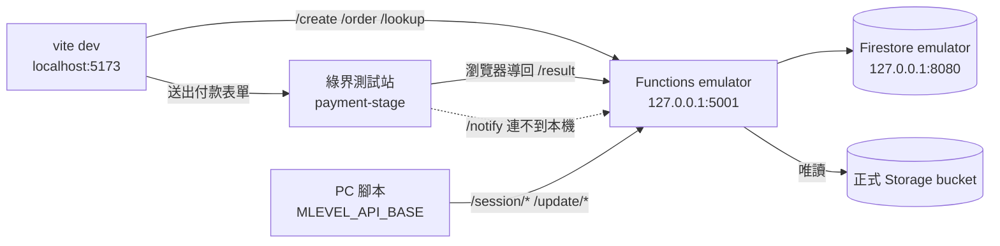

# 本機綠界測試環境規劃

2026-10-10

**狀態：已實作（2026-10-10）。** 第 1–4 項完成，`/create` 已在本機驗證（結帳網址為 payment-stage、特店 3002607、回呼指向本機、訂單寫入本機 Firestore）。實作時發現 emulator 與 `admin.firestore.FieldValue` 不相容，改了 `functions/index.js`（見「實作紀錄」）。另外用模擬的綠界回呼（自行以測試特店 HashKey 簽 CheckMacValue）在本機跑過 20 項 API 測試，全部通過，涵蓋 `/create`、`/notify`、`/result` 冪等、`/order`、`/lookup`、席位取得／搶占／心跳／釋放、`/verify`（426 與 `MLEVEL_REQUIRE_SESSION=false` 兩種）、`/download`。尚未做：在瀏覽器實際刷測試卡（測試清單 2 以後）、第 5 項 PC 腳本實機、第 6 項 `/notify` 通道。

## 目標

在本機跑完整的購買流程：網頁下單、到綠界測試站付款、發出授權金鑰、PC 腳本用這把金鑰啟動。整個過程不碰正式環境。

- 不修改 `functions/.env`、`mlevelweb/.env`、任何程式碼
- 測試訂單和金鑰只存在本機，不寫進正式 Firestore
- 測試完不需要改回任何設定，正式部署和打包都不受影響

## 現況

三端目前都指向正式環境。

| 端 | 設定位置 | 目前值 |
| --- | --- | --- |
| Functions | `mlevelweb/functions/.env` | `ECPAY_API_URL` 是正式結帳網址，MerchantID `3507844`；`ECPAY_CALLBACK_BASE_URL` 是正式 function 網址；`MLEVEL_APPCHECK_ENFORCE=true`；`MLEVEL_REQUIRE_SESSION=true` |
| 網頁 | `mlevelweb/.env` | `VITE_ECPAY_API_URL` 是正式 function 網址，App Check site key 已設定 |
| PC 腳本 | `mlevel/license_gate.py:38` | `DEFAULT_API_BASE` 是正式 function 網址，可用環境變數 `MLEVEL_API_BASE` 覆寫（`license_gate.py:39`） |

本機環境：

| 項目 | 狀態 |
| --- | --- |
| Java（firebase-tools 15 的 Firestore emulator 需要 21 以上） | ✅ 已用 winget 安裝 Microsoft OpenJDK 21.0.12，成為系統預設（JDK 17 仍保留在 `C:\Program Files\Java\jdk-17`） |
| Firebase CLI | ✅ 已全域安裝 firebase-tools 15.33.0，已登入 |
| gcloud ADC（Functions emulator 讀正式 Storage 用） | ❌ 尚未執行 `gcloud auth application-default login`，只影響下載與自動更新 |
| 網頁 `node_modules` | ✅ 已 `npm ci` |

## 做法：用 `.local` 覆寫檔，不改現有 `.env`

`firebase deploy` 讀的是 `functions/.env`。如果直接把它改成測試值，忘了改回去就部署，正式站會跑測試金流。所以測試設定全部放在只有本機會讀的覆寫檔：

| 覆寫檔 | 誰會讀 | 為什麼不會影響正式環境 |
| --- | --- | --- |
| `mlevelweb/functions/.env.local` | 只有 Functions emulator，優先順序高於 `.env` | `firebase.json` 的 functions `ignore` 含 `*.local`，部署不會上傳；`functions/.gitignore` 已排除 |
| `mlevelweb/.env.development.local` | 只有 `vite dev` | `vite build` 不讀 development 檔；`mlevelweb/.gitignore` 已排除 `.env.*` |
| PowerShell 環境變數 `MLEVEL_API_BASE` | 只有在同一個視窗啟動的 PC 腳本 | 關掉視窗就失效 |

## 架構



- **`/result` 可以入帳**：綠界付款完成後由瀏覽器把結果 POST 到 `/result`，瀏覽器連得到本機。`/result` 驗章後會呼叫 `markOrderPaid`（`index.js:876`），訂單照樣入帳、發金鑰。
- **`/notify` 收不到**：綠界伺服器連不到 127.0.0.1，會重送幾次後放棄，不影響測試。要測 `/notify` 見第 6 項。
- **Storage 還是連雲端**：下載和自動更新會讀正式 bucket，只讀不寫。

## 實作項目

### 1. 安裝 Firebase CLI

```powershell
npm install -g firebase-tools
firebase login
gcloud auth application-default login   # Functions emulator 讀正式 Storage 需要
```

也可以不全域安裝，改用 `npx firebase-tools ...`。

### 2. 新增 `mlevelweb/functions/.env.local`

```
ECPAY_API_URL=https://payment-stage.ecpay.com.tw/Cashier/AioCheckOut/V5
ECPAY_MERCHANT_ID=3002607
ECPAY_HASH_KEY=pwFHCqoQZGmho4w6
ECPAY_HASH_IV=EkRm7iFT261dpevs
ECPAY_CALLBACK_BASE_URL=http://127.0.0.1:5001/mlevel-f575a/asia-east1/ecpayApi
MLEVEL_APPCHECK_ENFORCE=false
```

| 欄位 | 為什麼要覆寫 |
| --- | --- |
| `ECPAY_*` 四個 | 換成綠界公開測試特店 3002607。程式只禁止公開金鑰配正式網址（`ecpay.js:47`），配 stage 可以用，不需要開 `ECPAY_ALLOW_PUBLIC_TEST_CREDENTIALS` |
| `ECPAY_CALLBACK_BASE_URL` | **一定要覆寫。** 保留正式網址的話，綠界測試站會把回呼送到正式 function，正式 HashKey 驗章失敗，本機訂單永遠不會入帳。留空的話，`getEcpayCallbackBaseUrl()`（`index.js:389`）推導出的 `http://127.0.0.1:5001/ecpayApi` 少了 `/mlevel-f575a/asia-east1`，一樣不能用 |
| `MLEVEL_APPCHECK_ENFORCE` | 本機前端送的是 App Check debug token，沒在 Console 註冊的話 `/create`、`/order`、`/lookup` 會回 401。要測 App Check 本身的話，見待決定事項 |

其他欄位（Storage、`MLEVEL_REQUIRE_SESSION` 等）沿用 `.env`。

### 3. 新增 `mlevelweb/.env.development.local`

```
VITE_ECPAY_API_URL=http://127.0.0.1:5001/mlevel-f575a/asia-east1/ecpayApi
```

- 付款後導回 `http://localhost:5173` 沒問題，`sanitizeRedirectBaseUrl` 預設允許 localhost 和 127.0.0.1（`index.js:433`）
- `firebase.json` 的 CSP 只套用在 Firebase Hosting，`vite dev` 不受影響

### 4. 啟動 emulator（必須帶 Firestore）

在 `mlevelweb/` 下執行：

```powershell
firebase emulators:start --only functions,firestore --import=./emu-data --export-on-exit
```

> ⚠️ **不要用 `functions/` 的 `npm run serve`。** 它是 `--only functions`，沒有 Firestore emulator，本機 function 會用你的 Google 帳號直接寫進**正式 Firestore**：測試訂單進到正式 `mlevel_orders`，測試金鑰在正式環境也能用。

- `--import` / `--export-on-exit` 用來保留測試資料，不需要的話拿掉，每次啟動都是空資料庫
- `emu-data/` 要加進 `.gitignore`（見待決定事項）
- 啟動後打開 `http://127.0.0.1:4000`（Emulator UI），確認 Functions 和 Firestore 兩個都在跑
- 確認 log 有讀到 `.env.local`：建立訂單時回傳的結帳網址應該是 `payment-stage`

另開一個視窗啟動網頁：

```powershell
cd D:\mLevelClaude\mlevelweb
npm run dev
```

### 5. PC 腳本連本機後端

```powershell
$env:MLEVEL_API_BASE = "http://127.0.0.1:5001/mlevel-f575a/asia-east1/ecpayApi"
$env:LOCALAPPDATA = "$env:TEMP\mlevel-localtest"
cd D:\mLevelClaude\mlevel
python mlevel.py
```

- emulator 發的金鑰只存在本機 Firestore，打正式後端會被判定成無效，所以 PC 腳本必須一起指向本機
- **`LOCALAPPDATA` 也要改**：授權快取寫在 `%LOCALAPPDATA%\mlevel\license.json`（`license_gate.py:155`）。不改的話，測試金鑰會覆蓋這台電腦原本的正式授權快取，測完要重新輸入正式金鑰
- 兩個環境變數都只在這個 PowerShell 視窗有效，關掉就恢復

### 6. （選用）測試 `/notify`

需要讓綠界伺服器連得到本機：

1. 用 cloudflared 或 ngrok 開通道，把 `http://127.0.0.1:5001` 對外公開
2. `functions/.env.local` 的 `ECPAY_CALLBACK_BASE_URL` 改成 `https://<通道網址>/mlevel-f575a/asia-east1/ecpayApi`
3. 重啟 emulator

`/notify` 和 `/result` 都會呼叫 `markOrderPaid`，有交易保護，重複回呼只會發一把金鑰，剛好可以一起驗證冪等性。

## 測試清單

| # | 步驟 | 預期結果 |
| --- | --- | --- |
| 1 | 網頁按購買、填 email | 跳轉到 `payment-stage.ecpay.com.tw`，不是正式站 |
| 2 | 用綠界測試信用卡付款（卡號 4311-9522-2222-2222、安全碼 222、任一未來到期日；以綠界文件為準） | 付款成功 |
| 3 | 綠界導回網頁 | 回到 `localhost:5173`，顯示訂單與授權金鑰 |
| 4 | Emulator UI → Firestore | `mlevel_orders` 有這筆訂單，含 `paidAt` 與金鑰 |
| 5 | Firebase Console → 正式 Firestore | **沒有**這筆訂單 |
| 6 | 網頁「找回授權」用同一個 email | 找得到金鑰 |
| 7 | PC 腳本輸入金鑰 | 啟動成功；Emulator UI 的 `mlevel_sessions` 出現一筆租約 |
| 8 | 另一個視窗（同樣設環境變數）用同一把金鑰再開一份 | 出現席位被占用、可選擇搶過來 |
| 9 | 關掉 PC 腳本 | 租約被釋放 |
| 10 | 檢查 `%LOCALAPPDATA%\mlevel\license.json`（原本的路徑） | 內容沒有被測試金鑰覆蓋 |

### 自動化：續訂功能整合測試

emulator 啟動後，在 `mlevelweb/` 執行 `node scripts/renew-test.cjs`。腳本自己簽綠界回呼，跑完新購、續訂、冪等、異常回呼、席位與下載共 48 項。它只連 `127.0.0.1`，`functions/.env.local` 的結帳網址不是 `payment-stage` 時直接中止。動到 `markOrderPaid`、席位或 `/download` 時重跑一次。

## 風險與檢查

| 風險 | 後果 | 防範 |
| --- | --- | --- |
| 用 `npm run serve` 或漏了 `firestore` | 測試資料寫進正式 Firestore，測試金鑰在正式可用 | 一律用第 4 項的指令；測試清單第 5 項確認 |
| 直接改 `functions/.env` 成測試值後部署 | 正式站跑測試金流，不收錢 | 只用 `.env.local`；不碰 `.env` |
| `ECPAY_CALLBACK_BASE_URL` 沒覆寫 | 綠界回呼打到正式 function，驗章失敗，本機訂單不入帳 | 第 2 項必填 |
| PC 測試沒改 `LOCALAPPDATA` | 正式授權快取被覆蓋 | 第 5 項 |
| `emu-data/` 進版控 | 測試訂單、email 進 git | 加進 `.gitignore` |

`.env.local` 和 `.env.development.local` 都不會被部署、打包或進版控，所以測試完不需要改回任何東西。

## 實作紀錄

| 狀況 | 原因 | 處理 |
| --- | --- | --- |
| emulator 啟動失敗：`firebase-tools no longer supports Java version before 21` | firebase-tools 15 要求 Java 21 | `winget install Microsoft.OpenJDK.21` |
| 第一次啟動時 `Cannot determine backend specification. Timeout after 10000` | 第一次啟動要同時下載 Firestore jar 與 UI，載入 function 定義超過 10 秒；手動跑 discovery 一秒內就回應 | 重新啟動即可。保險起見可以在啟動的視窗先設 `$env:FUNCTIONS_DISCOVERY_TIMEOUT = '60'` |
| `/create` 回 500：`Cannot read properties of undefined (reading 'serverTimestamp')` | emulator 把 `admin.firestore` 換成 `firestore.bind(admin)`（`firebase-tools/lib/emulator/functionsEmulatorRuntime.js:53`），bind 出來的函式沒有 `FieldValue`、`Timestamp` | `functions/index.js` 改用 `const { FieldValue, Timestamp } = require('firebase-admin/firestore')`，14 處 `admin.firestore.FieldValue/Timestamp` 改成 `FieldValue/Timestamp`。兩者是同一個物件（已驗證 `===`），正式行為不變、API 與資料格式不動；不需要馬上部署，下次部署時一起上 |

## 待決定事項

1. ~~**`emu-data/` 加進 `mlevelweb/.gitignore`**~~：已完成，同時加了 `firestore-debug.log`、`ui-debug.log`。
2. **`functions/package.json` 的 `serve`**：要不要改成 `firebase emulators:start --only functions,firestore`，避免之後誤用。改的是開發指令，不影響正式環境與舊版用戶。
3. **App Check**：本機要測 App Check 的話，把 `vite dev` 在瀏覽器 console 印出的 debug token 註冊到 Firebase Console → App Check，再把 `.env.local` 的 `MLEVEL_APPCHECK_ENFORCE` 拿掉。
4. **`functions/.env` 開頭註解過時**：註解說「stage 時三個欄位可以留空」，但 `ecpay.js:33` 的邏輯是一律必填，留空要另外開 `ECPAY_ALLOW_PUBLIC_TEST_CREDENTIALS`。建議照 `.env.example` 的說明更新。
