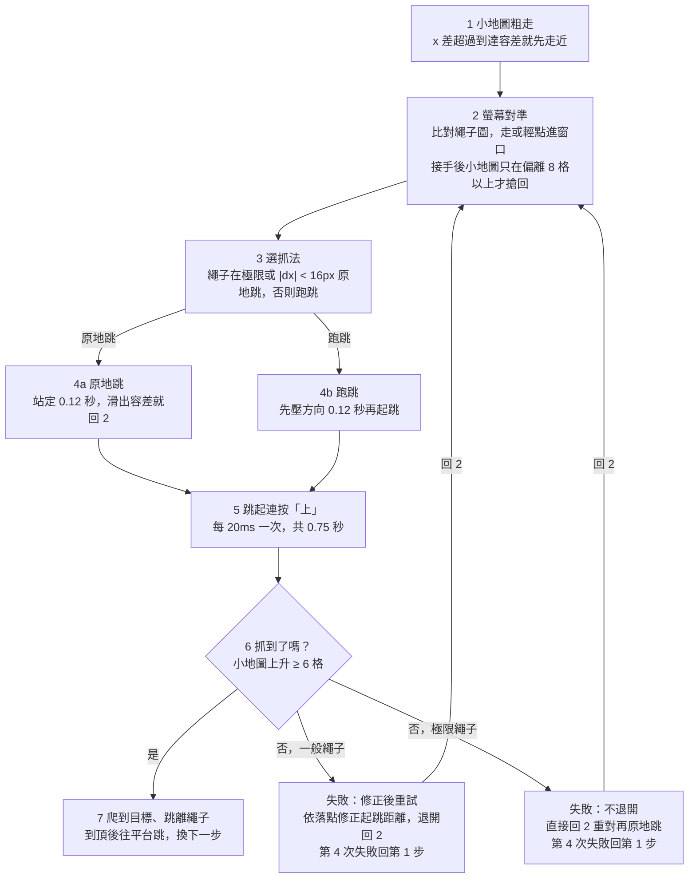

# mLevel 爬繩規範與調整紀錄

最後更新 2026-10-11（含當天修好的「繩下左右晃」，見文末「已解決問題」）· 舊版線上文件：https://claude.ai/code/artifact/46834b24-3836-4d1c-b096-704108a3a307（未同步本次更新）

## 概述

爬繩是路線裡的 `rope_up`／`rope_down` 步驟：先用小地圖走到繩子附近，再用螢幕上的繩子圖對準，跳起抓繩，爬到目標高度後跳離繩子。每一階段都用小地圖確認，不靠計時猜。

| 項目 | 位置 |
| --- | --- |
| 主流程 | `mlevel/mlevel.py` 的 `_climb()`（約 3307 行起） |
| 單步總時間上限 | `mlevel/mlevel.py` 的 `_follow_route()`（約 2827 行） |
| 卡住時的狀態紀錄 | `mlevel/mlevel.py` 的 `_climb_trace()`（約 3212 行） |
| 常數與其量測依據 | `mlevel/mlevel.py` 1145–1400 行 |
| 面板設定（路線走位頁） | `mlevel/mlevel.py` 634–638 行，預設值 236–243 行 |
| 繩子圖 | `templates/ropes/*.png`，設定鍵 `rope_templates` |
| 跨場學習記憶 | `config/rope_memory.json` |
| 抓繩逐幀截圖 | `log/grab/<時間>_step<N>/`（需開 `rope_film_enabled`） |
| 統計工具 | `tools/rope_dx_stats.py` |

爬繩只牽涉 PC 端腳本，不經過後端 `ecpayApi`，也不影響網頁。修改時要注意的相容性只有本機檔案：舊版的 `rope_memory.json` 和設定檔必須照樣讀得進來。

## 流程規範

一個爬繩步驟最多抓 4 次：第 1 次通常是原地跳，之後每次都用上一次量到的弧線修正起跳距離再跑跳。有成功紀錄的繩子會先重播成功過的距離。**繩底在跳躍極限的繩子例外：每次都是原地跳，失敗就回去重對，不跑跳。**



兩道時間保險，任一道到了就回第 1 步：
- **單步逾時**（預設 22 秒）：每次打怪都會歸零，所以在怪多的地圖可能永遠到不了。
- **單步總時間**：打怪不歸零，上限是單步逾時的 3 倍、最少 60 秒（預設 66 秒）。

各階段要遵守的規則：

1. **粗走**：小地圖一格約 20–30 遊戲像素，只用來走到繩子附近。退開助跑中、離繩 8 格內走回來時，或這一步已經在螢幕上看到繩子時，都不用小地圖（`mlevel.py:3387`）。**路線記錄的繩子 x 常和真正的繩子差 1–2 格，所以螢幕對準接手後，小地圖不能用 2 格的抵達容差搶回控制權**，否則兩邊會互相拉扯（見「已解決問題」第三輪）。
2. **對準**：只信螢幕上的繩子圖。繩子或人物錨點比對不到時**必須放開方向鍵站著等**，不能拿舊的 dx 繼續走。30px 內改用輕點，點的長度依誤差縮短。可以起跳的範圍：對準時間內是 ±10px（極限繩子 ±5px）；時間用完後放寬，至少 ±10px，向上爬時 ±15px，一般繩子則取起跳距離和這些值中較大的那個（`mlevel.py:3531`、`3612`）。
3. **選抓法**：繩底高過 84px（跳躍極限 92 減 8）時**一律原地跳**，不管 dx 多少（`mlevel.py:3708`），對準時間加倍為 1.2 秒。一般繩子跑跳時，人比起跳距離近超過 15px，要先退到起跳距離外。
4. **起跳**：原地跳不按任何方向，先站定 0.12 秒再重量。跑跳固定先壓方向 0.12 秒，讓同一個距離每次是同一種跳。
5. **連按**：跳起後在同一個 tick 裡每 20ms 按一次上鍵、共 0.75 秒，不交回主迴圈（`_grab_burst`）。
6. **判定**：上升 ≥ 6 格才算抓到；落回起跳高度 0.35 秒就判失敗，其他情況等滿 `rope_grab_seconds`。
7. **失敗後**：一般繩子用「落地 dx − 起跳 dx」修正起跳距離（半步修正），再退開助跑。**原地跳不修正起跳距離**（依實際抓法判斷，不是看 dx）。極限繩子不退開，直接回去重對，每次嘗試重新給 2 次「站定後滑開重對」的機會（`mlevel.py:3875`）。重播的距離若弧線差超過 30px，當作被怪擊退，免費重試，每步最多 2 次。

各階段要遵守的規則：

1. **粗走**：小地圖一格約 20–30 遊戲像素，只用來走到繩子附近。退開助跑中、或離繩 8 格內走回來時不用小地圖（`mlevel.py:3331-3338`）。
2. **對準**：只信螢幕上的繩子圖。繩子或人物錨點比對不到時**必須放開方向鍵站著等**，不能拿舊的 dx 繼續走（`mlevel.py:3339-3403`）。30px 內改用輕點，點的長度依誤差縮短。
3. **選抓法**：繩底高過 84px（跳躍極限 92 減 8）時只用原地跳，對準窗口減半為 5px，對準預算加倍為 1.2 秒。跑跳時人比起跳距離近超過 15px，要先退到起跳距離外。
4. **起跳**：原地跳不按任何方向，先站定 0.12 秒再重量。跑跳固定先壓方向 0.12 秒，讓同一個距離每次是同一種跳。
5. **連按**：跳起後在同一個 tick 裡每 20ms 按一次上鍵、共 0.75 秒，不交回主迴圈（`_grab_burst`）。
6. **判定**：上升 ≥ 6 格才算抓到；落回起跳高度 0.35 秒就判失敗，其他情況等滿 `rope_grab_seconds`。
7. **失敗後**：用「落地 dx − 起跳 dx」修正起跳距離（半步修正）。重播的距離若弧線差超過 30px，當作被怪擊退，免費重試，每步最多 2 次。
8. **到頂**：到達目標高度，或爬過 6 成後停住不動超過 `rope_grab_seconds`，就往平台跳離。一開始就已在目標高度表示站錯樓層，直接跳過這一步、不做跳離。

## 設定項與常數

使用者只能調面板上的 6 個設定，其餘都是寫死在程式裡的常數。常數的數字都來自實際量測，要改之前先讀 `mlevel.py` 上方的註解，那裡寫了當初量到什麼。

### 面板設定（路線走位頁）

| 面板名稱 | 設定鍵 | 預設 | 作用 |
| --- | --- | --- | --- |
| 繩子相似度 | `rope_confidence` | 0.75 | 繩子圖比對門檻 |
| 對繩容差 (px) | `rope_align_x` | 10 | 離繩子這麼近算「在正下方」，以內用原地跳、不按方向 |
| 起跳距離 (px) | `rope_jump_from_x` | 120 | 跑跳起跳距離的**上限**，實際距離是每根繩子學出來的 |
| 抓繩等待 (秒) | `rope_grab_seconds` | 1.5 | 弧線結束後等多久才判失敗；也是爬到不動多久算到頂 |
| 抓繩壓方向 (秒) | `rope_dir_hold_seconds` | 0.5 | 跑跳後方向鍵最多壓多久 |
| 單步逾時 (秒) | `route_step_seconds` | 22 | 任一非走路步驟的上限，夠試四種抓法。打怪會歸零；另有打怪不歸零的總時間上限 = 3 倍（至少 60 秒） |

另有兩個勾選項：`rope_jump_first`（預設開，先跳再按上）、`rope_film_enabled`（預設關，抓繩逐幀截圖）。

### 程式常數

| 常數 | 值 | 意義與依據 |
| --- | --- | --- |
| `ROPE_ON_ROPE_RISE` | 6 格 | 小地圖上升這麼多才算抓到。跳起來本身就會升 5 格，門檻 2 會把跳躍當成抓到 |
| `ROPE_BELOW_PLAYER_MAX` | 120 px | 繩底低於人物超過這個就是下一層樓的繩子，不要選 |
| `ROPE_GRAB_ARC_SECONDS` | 0.75 秒 | 跳起後每 20ms 連按上鍵的時間。每輪只按一次時 10 次只中 1 次 |
| `ROPE_AIM_START` | 30 px | 沒有紀錄的繩子從這個起跳距離開始。成功的 2,344 次中 93% 在 0–19px |
| `ROPE_AIM_MIN` | 16 px | 比這個近的「跑跳」其實是原地跳 |
| `ROPE_GRAB_MAX_TRIES` | 4 | 每步最多抓幾次，用完就回第 1 步 |
| `ROPE_WON_KEEP`／`POOL`／`APART` | 3／4／5 px | 每根繩重播幾個成功距離、池子放幾個、差多少算不同距離 |
| `ROPE_MISS_SECONDS` | 0.35 秒 | 落回原高度這麼久就判失敗，不等滿 `rope_grab_seconds` |
| `ROPE_CLOSE_IN_SECONDS` | 0.6 秒 | 原地跳前可以小步對準多久，超過就「直接在這裡抓」；繩子在極限高度時 ×2 |
| `ROPE_JUMP_REACH_PX` | 92 px | 跳到最高點腳底搆得到的高度（角色屬性，與地圖無關） |
| `ROPE_REACH_MARGIN` | 8 px | 繩底高過 84px 就算「極限」：只用原地跳，容差減半為 5px |
| `ROPE_RUNUP_SECONDS` | 0.12 秒 | 跑跳前固定先壓方向多久，讓同一距離是同一種跳 |
| `ROPE_SETTLE_SECONDS` | 0.12 秒 | 原地跳前先站定，放開方向鍵人不會馬上停 |
| `ROPE_SETTLE_RETRIES` | 2 | 站定後發現滑出容差，最多回去重對幾次 |
| `ROUTE_STEP_HARD_FACTOR`／`SECONDS` | 3／60 秒 | 單步總時間上限 = max(60, 3 × 單步逾時)，打怪不歸零 |
| `ROPE_TRACE_AFTER_SECONDS`／`SECONDS` | 10／3 秒 | 一步超過 10 秒（含打怪）還在走位，就每 3 秒寫一行「還在找位置」 |
| `ROPE_BACKOFF_SECONDS` | 2.5 秒 | 重試跑跳前退到起跳距離外最多走多久 |
| `ROPE_RUNUP_MINIMAP_PX` | 8 格 | 退開後走回來、或螢幕已接手對準時，離繩子這麼近就不用小地圖粗走 |
| `ROPE_RUNUP_SLACK_PX` | 15 px | 比起跳距離近超過這個才退開 |
| `ROPE_SHOVE_PX`／`ROPE_FREE_RETRIES` | 30 px／2 | 重播距離失敗且弧線差太多，當作外力打斷，免費重試最多 2 次 |
| `ROPE_NUDGE_FROM_X`／`SECONDS` | 30 px／0.06 秒 | 30px 內改用輕點對準，每點約 10px |
| `ROPE_BODY_ROWS`／`MAX_WIDTH` | 30／16 px | 繩子圖應該只截繩身約 9×30。截整條繩會讓位置跳 150px |
| `ROPE_OCCLUDER_PX` | 90 px | 有人掛在繩上時，找繩底可以跨過的空段 |
| `ROPE_FOOT_RELAX`／`RUN` | 0.75×／8 列 | 往下找繩底時放寬的門檻，連續 8 列才算 |
| `ROPE_COVERED_PX` | 60 px | 繩底比看過最低的高這麼多就是被擋住，沿用舊值 |

## 學習記憶 rope_memory.json

每根繩子學到的起跳距離和成功過的距離存在 `config/rope_memory.json`，跨場保留。刪掉這個檔就從頭學，不會壞任何東西。

```json
{
  "version": 1,
  "routes": {
    "弓箭手訓練場1-下3層": {
      "76.6|75.6": { "aim": 53.5, "won": [[6.5, 1.0]] }
    }
  }
}
```

- 第一層依**路線名稱**分開；存檔時只覆寫目前路線，別的路線保留。
- 繩子的 key 是該步驟的 `x|to_y`（各取到小數一位），不是步驟編號，所以插入新步驟不會串到別根繩。
- `aim`：修正過的起跳距離（px），`null` 表示還沒修正，用 `ROPE_AIM_START`。
- `won`：成功過的 `[距離 px, 方向]`，方向 `1.0` 代表繩在人右邊、`-1.0` 在左邊。最多 4 筆，按成功次數排。
- 讀入時每筆都當成成功 1 次、沒有時間戳；檔案壞掉就清空從頭學，不會報錯中斷。

**相容性規則**：只能加欄位，不改既有欄位的意義；舊版腳本讀到新欄位要能忽略。

**什麼時候該刪**：換了移動速度或跳躍等級、重錄了路線或繩子圖。極限繩子的 `aim` 不會被用到，2026-10-11 之前留下的大數字（例如 87.9）可以改成 `null`，不影響運作。

## log 判讀

爬繩的訊息都以「路線第 N 步：」開頭，寫在 `log/auto_hunt.log`。一個正常的爬繩是「對準繩子 → 抓到了 → 爬到 → 離開繩子 → 完成」，大約 3 秒。

| 訊息開頭 | 代表什麼 | 怎麼處理 |
| --- | --- | --- |
| 對準繩子（繩子 x=…，dx=…） | 已對準，即將跳 | 正常 |
| 在繩子正下方…原地跳 | 改用原地跳 | 正常 |
| 距離 dx=…，往右／左走著跳進繩子 | 跑跳 | 正常 |
| 站定後重新量到 dx=…，先回去重對 | 放開方向鍵後人滑出容差 | 每步最多 2 次，偶爾出現正常 |
| 抓繩失敗（…小地圖 y 起點…） | 弧線沒抓到 | 看下一行是「衝過頭」還是「已經落在繩子上」 |
| 衝過頭——起跳 dx=… → 落地 dx=… | 起跳太近，已自動加大起跳距離 | 正常學習，等下一次 |
| 弧線已經落在繩子上了，還是沒抓到 | 位置對但沒觸發抓取 | 開 `rope_film_enabled` 看 `log/grab` 的逐幀畫面 |
| 這根繩子的底端高出人物 …px | 繩底在跳躍極限，只用原地跳 | 一直失敗就換低一點的繩子重錄 |
| 繩子下半截被擋住了 | 有人掛在繩上，沿用舊的高度 | 正常 |
| 附近找不到繩子（最佳分數…） | 繩子圖比對不到 | 確認這張地圖的繩子圖有加入，或重截 |
| 附近的繩子都在腳下 | 站錯樓層 | 檢查前一步是否失敗 |
| 等人物錨點回來再對繩 | 人物比對不到 | 一直卡住就把「人物相似度」調低 |
| 這根繩子在跳躍極限，不退開助跑，回去重新對準再原地跳 | 極限繩子失敗後的重試 | 正常 |
| 還在找位置（小地圖粗走：…） | 一步超過 10 秒還在用小地圖走近 | 從上一步走過來、途中打怪時出現是正常的 |
| 還在找位置（走向繩子／輕點對準：dx=…，可起跳範圍 ±…） | 螢幕對準一直進不了範圍 | 看 dx 有沒有在縮小；和「小地圖粗走」交替出現就是兩邊在拉扯 |
| 試了 4 次都沒抓到繩子；跳過 | 放棄這一步，回第 1 步 | 連續出現就開截圖查 |
| …逾時；跳過 | 單步超過 22 秒（打怪會歸零） | 同上 |
| …連打怪在內已經 N 秒還沒完成 | 單步總時間到了（預設 66 秒） | 同上；如果是走近繩子時一直在打怪，屬正常保護 |

**警訊**：「還在找位置」連續出現、而且 dx 沒有在縮小，就是卡在對準階段。

## 調整紀錄

爬繩從 2026-08-30 開始大改，共 9 個相關 commit。每一次都是先從 log 或逐幀影片量到現象，再改程式。完整量測在 `README.md`「爬繩、跳躍、下跳」與「抓不到繩子」兩節。

| 日期 | commit | 現象 | 改了什麼 |
| --- | --- | --- | --- |
| 2026-10-11 | 未 commit | 繩下左右晃、不跳也不逾時；極限繩子一直跑跳 | 見「已解決問題」：放寬過期範圍、單步總時間上限、換步重設計時、極限繩子只原地跳、螢幕接手後小地圖不搶回、卡住時寫狀態 |
| 2026-10-10 | `143b533` | 抓繩錄影一直寫檔佔空間 | 新增 `rope_film_enabled`，預設不勾；勾選框初始值改讀 `DEFAULT_CONFIG` |
| 2026-10-10 | `fd6dcec` | 起跳距離修到 97px，實際起跳 dx 仍是 17–23px，四次全衝過頭 | 重試前先真的退到起跳距離外（`ROPE_BACKOFF_SECONDS`），走回來改看螢幕 dx；學到的距離存入 `rope_memory.json` 跨場保留 |
| 2026-09-25 | `261c02c` | 弧線橫移量到的是鏡頭移動，不是角色 | 爬繩階段 `player_x` 凍結，落地時改用當下重量的人物位置 |
| 2026-09-24 | `048483f` | 沒紀錄的繩從 120px 開始試，反而沒成功過；異常弧線把起跳距離拉到上限 | 新增 `ROPE_AIM_START = 30`；原地跳不再修正起跳距離；超過上限的弧線丟棄 |
| 2026-09-24 | `97ab965` | 有人掛在繩上時整根繩都比不到（0.54–0.67 分） | 嚴格門檻全滅時用放寬門檻再找；找不到時存一張現場 `norope_*.jpg` |
| 2026-09-20 | `43c13ef` | 繩底掃描把每根繩的繩底量低 17px，x 誤差 ±6px | 掃描只提供高度，x 與分數用全信心比中點；跨過一個繩子圖高的空白後才放寬 |
| 2026-09-19 | `727adb6` | 有人掛過一次，那根繩整場只剩原地跳 | 新增 `_rope_foot()` 看穿遮擋；`rope_gap_min` 改存最小值；被擋時沿用舊高度 |
| 2026-08-30 | `2a13058` | 弓箭手訓練場第 2 層 9 次中 1；繩下 ±50px 來回抖；失敗後停 1.95 秒 | 加入極限高度只原地跳；看不到繩子就放開方向鍵；輕點對準與 0.6 秒預算；0.35 秒判失敗；每 20ms 連按；起跳距離逐步修正並依繩子分開記；被怪打斷不算數 |
| 2026-08-30 | `016854c` | 失敗只知道「小地圖 y 沒變」，分不出原因 | 抓繩那 0.75 秒逐幀存到 `log/grab/` |

兩個沒有改程式、但影響設定的結論：

- **對繩容差維持 10，不要調小**。2026-08-16～08-30 共 1,940 次抓繩，dx 從 −10 到 +10 都有成功，瞄準點就是 dx=0。
- **繩子圖只截繩身約 9×30**。截整條繩分數約 0.78，貼著門檻會掉幀；只截繩身實測 0.83–1.00。

## 已解決問題

### 繩下左右晃、抓不到繩（2026-10-11 修，未 commit）

**要解決什麼**：弓箭手訓練場1-下3層的第 2 步（繩子 x=76.6，繩底高出人物 88–126px，剛好在跳躍極限 92px 附近），角色會在繩子下面左右來回走、不起跳，也不逾時。v1.1.0 實測 10:56:21–10:58:04 卡了約 100 秒，11:00:58 又卡一次，只能手動停掉。

前後跑了三輪測試才找齊原因：每修好一層，下一層才看得到。

#### 第一輪：走不進範圍時沒有真正放寬，而且永遠不逾時

| 原因 | 怎麼解決 |
| --- | --- |
| 上一輪在 6.5px 原地跳成功，重播時起跳距離 = 6.5。對準時間用完後，可起跳範圍改成起跳距離 6.5px，比原本的 10px 還窄；「直接在這裡抓」的條件 10 < \|dx\| ≤ 6.5 永遠不成立，於是一直輕點想擠進 ±6px | 時間用完後範圍至少放寬到 `rope_align_x`（10px），向上爬時再放寬到 15px（`mlevel.py:3612`） |
| 每次打怪都把單步逾時歸零（`route_since`），怪每 2–5 秒出現一次，22 秒逾時永遠到不了 | 新增打怪不歸零的單步總時間上限：max(60, 3 × 單步逾時)，預設 66 秒，到了就回第 1 步（`mlevel.py:2827`） |
| 換步時沒重設對準計時（`route_phase_since`），每個爬繩步驟一進來就判定時間已用完 | 換步、回第 1 步時一併重設；小地圖粗走期間也持續重設，讓對準時間從螢幕接手時才開始算（`mlevel.py:4106`、`4134`） |

驗證（11:37–11:43）：不再卡 100 秒，「直接在這裡抓」和總時間上限都有觸發。但第 2 步仍然 8 次嘗試只抓到 1 次。

#### 第二輪：極限高度的繩子一直在跑跳

| 原因 | 怎麼解決 |
| --- | --- |
| 對準時間用完後，可起跳範圍會參考學來的起跳距離（30–88px），人離繩子 16px 以上就變成跑跳，例如從 dx=−58 起跳 | 極限繩子不看起跳距離，範圍最多 15px（`mlevel.py:3531`） |
| 起跳時只看 dx 決定原地跳或跑跳 | 極限繩子一律原地跳，不管 dx（`mlevel.py:3708`） |
| 抓失敗後一律退開再助跑 | 極限繩子失敗後不退開，直接回去重對再原地跳，並重新給 2 次重對機會（`mlevel.py:3875`） |
| 跑跳失敗會修正起跳距離，把它推成 30→64→43→74→79→65→88，存進記憶檔 | 改用「實際是不是原地跳」判斷，原地跳一律不修正起跳距離；記憶檔裡的 87.9 清成 `null` |
| 走路和輕點的那段程式沒有 log，卡住時只看得到一片空白 | 一步超過 10 秒還在走位，就每 3 秒寫一行「還在找位置」，附 dx、可起跳範圍、小地圖 x（`_climb_trace`） |

驗證（11:53–11:55）：沒有再跑跳。但新加的紀錄顯示，左右晃還在，原因是第三輪這一項。

#### 第三輪：小地圖粗走和螢幕對準互相拉扯（左右晃的根本原因）

「還在找位置」的紀錄交替出現：

```
小地圖粗走：小地圖 x=73.5／繩 x=76.6（容差 2）
走向繩子：dx=-36，可起跳範圍 ±5px，小地圖 x=76.6／繩 x=76.6
小地圖粗走：小地圖 x=74.6／繩 x=76.6（容差 2）
走向繩子：dx=-36 …
```

| 原因 | 怎麼解決 |
| --- | --- |
| 路線記錄的繩子 x（76.6）比真正的繩子偏右約 1.5 格小地圖。小地圖把人帶到 76.6，螢幕看到繩子在左邊 36px，往左走；小地圖 x 一掉到 74.5，超出抵達容差 2 格，小地圖粗走又把人拉回 76.6。兩邊輪流接手，就是左右晃 | 螢幕上一看到繩子，這一步的小地圖就退讓：只有偏離超過 8 格（`ROPE_RUNUP_MINIMAP_PX`，例如被擊退、掉下去）才交回小地圖粗走（`mlevel.py:3387`，旗標 `climb_on_screen`，每步重設） |

驗證（12:11–12:15）：兩圈 4 次爬繩全部第一跳就抓到，從對準到離開繩子約 3 秒，沒有再左右晃。

| 時間 | 步驟 | 結果 |
| --- | --- | --- |
| 12:12:43 | 第 2 步（極限繩子） | 原地跳 dx=+8，一次抓到 |
| 12:13:03 | 第 4 步 | 重對 1 次，原地跳 dx=−8 抓到 |
| 12:14:18 | 第 2 步 | 原地跳 dx=+4，一次抓到 |
| 12:14:32 | 第 4 步 | 重對 1 次，原地跳 dx=−8 抓到 |

**相容性**：只改 `mlevel.py`，沒有動 API、金鑰、`rope_memory.json` 格式和設定檔格式；舊的記憶檔照樣讀。

**副作用**：螢幕接手後，如果 8 格（約 200 遊戲像素）內畫面上有另一根繩子，可能對到那根，小地圖也不會再拉回來。其他地圖有兩根很近的繩子時要留意。

## 已知問題

- [ ] **「還在找位置」在正常情況也會出現**：計時含打怪，從上一步走向繩子途中打怪超過 10 秒就會印。不是卡住，只是 log 比較吵。可改成扣掉打怪時間，或把門檻調高。
- [ ] **人物錨點常常差一點比對不到**：2026-10-11 12:11–12:15 最佳分數 0.79–0.819、門檻 0.82，掉了 5 次，第 4 步因此多等 1 秒。和爬繩無關，應是人物圖換成 `Screenshot_2.png` 所致；「人物相似度」調到 0.78 左右應可改善。
- [ ] **總時間上限會被走近繩子時的打怪吃掉**：11:38–11:39 那輪光走近繩子就打了 52 秒，真正抓繩只試了 2 次就到 66 秒。可考慮改從第一次在螢幕上對準繩子開始計時。
- [ ] **極限繩子站定後常滑開 10–14px**：放開方向鍵後人還會滑，方向幾乎固定，幾乎每次都要重對 1 次。目前靠重對解決，不影響成功率。
